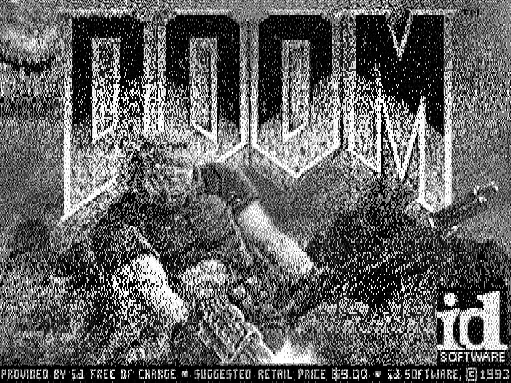

# DOOM on Oberon

> **operating system** *(n.)* — anything that runs DOOM.

By that definition, Project Oberon has qualified at last.

**DOOM, as an Oberon command, on Niklaus Wirth's RISC5 machine** — compiled by a C
toolchain written for it in OCaml, loaded by a small Oberon-07 module, and run on the
[Hardcaml RISC5](https://github.com/zxygentoo/oberon-risc-hardcaml) on a Digilent Nexys 4,
on its cycle-accurate model, and on the
[emulator](https://github.com/zxygentoo/oberon-risc-emu-ocaml).



*The title screen on the booted disk image, in the emulator: DOOM's 320 × 200 palette
frame dithered to the machine's one-bit screen. On the board, the same dithering happens
in the display hardware.*

On the board DOOM runs at **15 frames a second** at 64 MHz, fullscreen or in a viewer
beside the live desktop, and its timedemo ends at exactly the tick count of a reference
PC build.


*On the board, in a viewer (photo from the hardware repository).*

## What is in here

| Path | What |
|---|---|
| `lib/`, `bin/doomcc.ml` | the compiler: the CIL front end, the RISC5 backend, the linker, and the hand-written runtime and drawers |
| `libc/` | the mini-libc, the doomgeneric platform layer, the one-bit dither |
| `patch/c/` | the port's changes to doomgeneric |
| `patch/oberon/` | the loader, `DOOM.Mod`, and a raw-scancode tap for Oberon's `Input` module |
| `ABI.md` | the contract between them: registers, calls, types, the blob format, the memory map, the Halftone display interface |
| `test/` | the differential jig: the compiler against gcc |
| `bin/run_*.ml`, `sim/` | DOOM on the emulator, on the booted OS, and on the cycle-accurate model |

## How it works

**Compiling.** No C compiler existed for RISC5, so this repository has one, in OCaml.
The [CIL](https://github.com/goblint/cil) front end parses
[doomgeneric](https://github.com/ozkl/doomgeneric)'s 80 translation units and a small
libc and merges them into one program. The backend selects RISC5 instructions with a
deliberately simple register allocator, and refuses anything outside the ABI rather than
miscompile it. The hottest loops — the dither, `R_DrawSpan`, `R_DrawColumn` — are
hand-written in an OCaml eDSL over the same instruction type, each checked against gcc
compiling the C it replaces. An instruction-level linker lays it all out as `doom.blob`:
a header, code, data, and a symbol map beside it.

**Loading.** `DOOM.Mod` is an ordinary Oberon module, compiled by Oberon's own compiler.
It reads `doom.blob` and the WAD — split into two files, since the Oberon file system
caps a file at about 3 MB — into the memory above Oberon's own megabyte, and calls the
blob's entries: `Init` once, `Tick` once a frame, `KeyIn` for each key. Each entry
switches to a C stack and back. DOOM never touches storage, the WAD arrives as a
pointer, and when DOOM quits or fails, control returns to Oberon.

**Drawing.** DOOM renders 320 × 200 palette frames. On the board the Halftone display
mode dithers them onto the one-bit screen as it scans out; elsewhere the blob dithers in
software. Both make the same pixels.

**Keys.** DOOM needs press and release, which Oberon's `Input` module throws away, so
the loader reads raw PS/2 scancodes.

## Getting started

Linux on x86-64, [opam](https://opam.ocaml.org), gcc with 32-bit multilib (the test
oracle compiles for the target's data model), and SDL2 for the emulator window.

```sh
git clone --recurse-submodules https://github.com/zxygentoo/DOOM-on-Oberon.git
cd DOOM-on-Oberon

opam switch create default 5.3.0              # or use an existing stock switch
opam install --switch default --deps-only .   # goblint-cil, crunch
opam install --switch default tsdl imagelib   # the emulator window
make prereqs                                  # checks the rest, with install hints

make        # the blob and the bootable disk image, in _out/
make run    # boot a copy in the emulator
```

`make` downloads the shareware `doom1.wad` and checks its md5. In the emulator, click
`DOOM.Run` with the **middle** mouse button (Left Alt on a trackpad) in the `System.Tool`
viewer; `DOOM.Run -win` opens DOOM in a viewer instead, on hardware with the Halftone
display mode. The emulator has no Halftone, so there `DOOM.Run` dithers in software.

| Key | In DOOM |
|---|---|
| arrows | move and turn |
| Ctrl | fire |
| Space | use (doors, switches) |
| Shift | run |
| Alt | strafe, with the arrows (`,` `.` strafe too) |
| 1 – 7 | weapons |
| Esc, Enter | the menu |
| Tab | the map |
| F10, then `y` | quit back to Oberon |

In a viewer, the keys go to DOOM while the mouse pointer is over the game.

## Checking it

| Gate | What it checks | Time |
|---|---|---|
| `make test` | the differential jig: about 250 C samples compiled by this compiler and run in the emulator, against host gcc, plus self-checks and the refusals | 5 min |
| `make check` | DOOM's demo on the emulator against a host build of the same sources: the framebuffer bit-identical at four points, and both runs ending at exactly 5026 game ticks | 7 min |
| `bin/run_dsk.exe` | the disk image on the booted OS, driven by a scripted timeline of keys and clicks | minutes |
| `make sim` + `run_sim` | the blob on the cycle-accurate model of the shipped machine ([`sim/README.md`](sim/README.md)) | an hour |

`make ref` builds DOOM for the PC from the same patched sources, with SDL — the
reference the tick count comes from.

## How fast

| | Clocks per tick | Frames a second |
|---|---|---|
| the board, 64 MHz, through Halftone | — | **15.0** |
| the cycle-accurate model, through Halftone | 3.53 M | 18.2 |
| the cycle-accurate model, software dither | 7.19 M | 8.9 |

The frame rate was chosen by measurement: profiles of the blob found most of each frame
in four functions, and the levers that paid were hand-writing those loops, moving the
dither into the display hardware, and a 16 KiB cache on the board. Better register
allocation and general inlining were priced and parked
([`build-log.md`](build-log.md)).

## On a board

You need a Nexys 4 (the original, with cellular RAM) set up as in
[the hardware repository](https://github.com/zxygentoo/oberon-risc-hardcaml#on-a-board),
running its `v0.1.0` bitstream
([`oberon.bit`](https://github.com/zxygentoo/oberon-risc-hardcaml/releases/tag/v0.1.0)),
and a microSD card. The disk image is the Oberon file system
alone; the board expects it 0x80002 blocks into the card:

```sh
sudo dd if=_out/DOOM.dsk of=/dev/sdX bs=512 seek=524290 conv=fsync
```

Boot, then middle-click `DOOM.Run` or `DOOM.Run -win`.

## Documents

- [`AGENTS.md`](AGENTS.md) — the working rules: the gates, the invariants, the layout,
  the conventions and traps.
- [`docs/design.md`](docs/design.md) — the design: the decisions, the toolchain, the
  runtime, input, verification.
- [`ABI.md`](ABI.md) — the frozen contract between compiler, blob and loader.
- [`sim/README.md`](sim/README.md) — the cycle-accurate leg.
- [`build-log.md`](build-log.md) — how it was built, slice by slice, with every
  measurement.

## Related repositories

- [`oberon-risc-hardcaml`](https://github.com/zxygentoo/oberon-risc-hardcaml) — the
  machine: the Hardcaml RISC5, its board layer and the Halftone display mode, vendored
  here as a submodule.
- [`oberon-risc-emu-ocaml`](https://github.com/zxygentoo/oberon-risc-emu-ocaml) — the
  emulator and the disk-image tools, nested in the hardware repository; the compiler
  shares its instruction encoding.

## Credits

DOOM is id Software's; doomgeneric is ozkl's, on Chocolate Doom by Simon Howard. Project
Oberon and RISC5 are the work of Niklaus Wirth, Jürg Gutknecht and Paul Reed
([projectoberon.net](http://www.projectoberon.net)). CIL is maintained by the
[Goblint](https://goblint.in.tum.de) project. The emulators descend from Peter De
Wachter's [oberon-risc-emu](https://github.com/pdewacht/oberon-risc-emu).

## License

[MIT](LICENSE) for this repository's own code. DOOM's code, the patches to it, and the
built blob and disk image are GPL-2.0-or-later; the disk image also carries Project
Oberon 2013 and the shareware WAD. [`THIRD_PARTY.md`](THIRD_PARTY.md) lists what derives
from other work and the terms it carries.
